# Mobile on the native core: research and prototypes

How much of the native desktop client (`desktop-native/`) Android and iOS
can share, and how. The goal (owner, 2026-11-10) is to share the Qt/QML
views themselves, not only the Rust core, and make them look and behave
native on each platform. This folder holds the research, two Android
prototypes on the same unchanged core, and their side-by-side measurements:

- `qt/`: **Qt Quick on Android**, the main path. The desktop's QML,
  list models and portable C++ run on a phone, under a mobile shell and a
  thin platform shim. Application id `dev.yap.app`, label "Yap" (CI's
  builds: `dev.yap.app.ci`, "Yap CI").
- `rust/` and `android/`: **the Compose baseline**. The same core behind
  UniFFI with Jetpack Compose views, kept to compare against. Application
  id `dev.yap.coreproto`.

The Expo app (`apps/mobile`) is untouched and keeps shipping. Nothing here
is built by its workflows or changes its package, signing or store listing.

## Recommendation

**Go with Qt Quick (a) as the mobile view layer, sharing QML with the
desktop.** The prototype shows the sharing is real, the platform gaps are
small shims, and scrolling is smooth. The costs are measured, not
estimated: a larger download, higher memory, and a short list of things
that feel off, each with a known fix.

- **Shared, one copy:** the `yap-ui` crate (`desktop-native/rust/crates/yap-ui`),
  which both apps link. It holds the `Yap.Ui` QML module (`Theme`,
  `ShellState`, `MessageDelegate`, `TreeRow`, `ServerIcon` and the
  components they use: 36 files, 5,408 lines), the domain objects (`Session`, `Nav`,
  `Chat`, `Voice`, `Profile` and the portable singletons such as `Admin`,
  `Emoji`, `Extras`, `Invites`, `Panels`), all 13 list models, the
  GUI-thread registry, the core's runtime and gateway, and the portable C++
  (`AnimatedPicture`, the icon and dither image providers). Together with
  the core, that is everything a row shows and every rule behind it.
- **Per platform:** about 7,400 lines of QML (shell, pager, pages,
  composer, upload tray, image viewer, the sheets and message actions,
  Settings and Friends, and
  the mobile side of four seams), about 720 lines of Rust (the app's
  `Platform`: TLS client, realtime, token store, and the HTTP behind Qt's
  own loads), and about 1,650 lines of C++/Java: the shim for back,
  keyboard, haptics, share, the photo picker, text size, fling and the
  system bars, and Qt's network access over the core's client.
- **Verified on the emulator:**
  - Kova sign-in, the server rail, the channel tree and `#general`, with
    the desktop's grouping, mention rows, role colours and Markdown;
  - send from the composer, and a live message from the peer arriving over
    the gateway;
  - the keyboard pushing the composer up as it animates;
  - the predictive back gesture (the page follows the finger, then pops);
  - edge to edge under the system bars, and light mode from the system;
  - 60 Hz scrolling through 170 messages;
  - a long press opening the message sheet, and from it a reaction, a
    reply, an edit and a delete arriving at the peer; swipe to reply; the
    emoji sheet's search and skin tone; text at the system's 1.3 size.
- **The price, against the Compose baseline:**
  - about 9 MB more to download (21 MB vs 12.6 MB gzipped);
  - 2.5x the memory after scrolling (148 MB vs 60 MB PSS);
  - Qt's own HTTPS needs OpenSSL on Android; pictures go over the core's
    rustls client instead (see "Gaps").

Keep the Rust boundary exactly as it is: the core does not know which view
layer draws it, and the Compose baseline proves a native view stays possible
for any one surface (for example a call screen) if Qt ever falls short there.

## What is shared, what is per platform

| Layer                         | Shared with desktop (unchanged)                                                                                                                                                                                                                                                                                                                       | Per platform                                                                                                                                                                                                                                                                                                     |
| ----------------------------- | ----------------------------------------------------------------------------------------------------------------------------------------------------------------------------------------------------------------------------------------------------------------------------------------------------------------------------------------------------- | ---------------------------------------------------------------------------------------------------------------------------------------------------------------------------------------------------------------------------------------------------------------------------------------------------------------- |
| Core                          | `yap-core`, `yap-cache`, `yap-realtime`, `yap-protocol`, `yap-anim`; `gateway.rs`                                                                                                                                                                                                                                                                     | TLS backend (rustls on mobile), the token store (sealed with an Android Keystore key, `qt/vault`), the config and data folder handed in (`yap_mobile_init`)                                                                                                                                                       |
| Models and bridge objects     | yap-ui: every `QAbstractListModel` (servers, tree, messages, members, DMs, …), `Session`/`Nav`/`Chat`/`Voice`/`Profile` and the portable singletons, one definition for both apps; the registry and the order view updates apply in                                                                                                                   | The app's `Platform` (`yap_ui::platform`): HTTP client, realtime, token store, start and quit hooks, the view updates only it shows (toasts, sounds, badge), uploads, share sources, video. Desktop: `rust/src/native.rs`; mobile: `qt/rust/src/client.rs`                                                       |
| Theme tokens                  | `Theme.qml` (palettes, type roles, motion, spacing), `ShellState.qml`                                                                                                                                                                                                                                                                                 | Which theme (Settings' choice; Match system, the default, follows the light/dark mode), the text size factor (`Prefs`), and the input flags the shell binds: `Theme.touch`, `Theme.hoverUi`, `Theme.textScale`                                                                                                   |
| Components and list delegates | `Yap.Ui`: `MessageDelegate` (the message renderer: grouping, replies, reactions, mention and pending rows, Markdown via Qt rich text), `TreeRow`, `ChannelRow`, `CategoryLabel`, `MemberRow`, `ServerIcon`, `RailPill`, `CountBadge`, `Avatar`, `DisplayName`, `Icon`, `IconKey`, `KitButton`, `Led`, `Spinner`, `LinkText`, `LazyPopup`, `Tooltip` … | Each app's side of the four seams the shared files import from `Yap.Platform`, with the same API: `EmbedCard`, `MessageMedia`, `VoiceStatusLine`, `VoiceStreamHoverCard` (mobile: `qt/rust/qml/seams`; desktop: its own `com.yap.native` files)                                                                  |
| C++                           | yap-ui `cpp/`: `AnimatedPicture` and `ViewportWatch` (GIF/APNG/WebP through yap-anim), the `icon` and `dither` image providers, `yap_ui_register(engine)`; `yap_ui.cmake` compiles them in each app's target                                                                                                                                          | `Native` (the platform shim) and `main.cpp`. The Windows C++ (window chrome, toasts, WebView2, Media Foundation, D3D11 video) stays desktop-only                                                                                                                                                                 |
| Page layouts and navigation   | `ConnectionStrip`, `UnreadBanner`, `PresenceAvatar`, `GameLine` (moved into `Yap.Ui` for the phone pages; the desktop uses the same files)                                                                                                                                                                                                            | The pager and its pages (`Pager`, `DrawerPage`, `DmsPane`, `ChatPage`, `MembersPage`), the stacked `ProfilePage`, `SettingsPage` and `FriendsPage`, phone-sized rows where the desktop's are pointer-sized (`DmItem`, `MemberItem`, `AccountBar`), `PlatformList` (the platform's scroll feel). See "Navigation" |
| Shell                         | —                                                                                                                                                                                                                                                                                                                                                     | `Main.qml` (edge to edge, phases, foreground/background), the Android manifest, the Java shim                                                                                                                                                                                                                    |

### How the sharing is built

One crate, one QML module, two consumers. No file is copied:

- **`yap-ui`** (`desktop-native/rust/crates/yap-ui`, `links = "yap_ui"`) is a
  cxx-qt crate that owns the QML module `Yap.Ui` (its QML lives in the
  crate, `qml/`; its bridge files in `src/`, one flat folder, as cxx-qt-build
  requires). Its build script ends with `.build().export()`, so cxx-qt-build
  hands its initializers to the app crate that links it and exports the
  module under `CXX_QT_EXPORT_DIR/qml_modules/Yap/Ui`.
- **Each app crate** (`yap_native` on the desktop, `yap_mobile_qt` here)
  depends on it by path. Its CMake imports both modules from the one crate it
  builds: `cxx_qt_import_qml_module(yap_ui_qml URI "Yap.Ui" SOURCE_CRATE
<app crate>)` beside its own, and includes `yap-ui/cpp/yap_ui.cmake` for the
  shared C++ (an INTERFACE library, so it compiles with the app's flags).
- **The app's own QML** is its own module: `com.yap.native` on the desktop,
  `com.yap.mobile` here. Its files `import Yap.Ui`.
- **Seams.** Shared QML imports `Yap.Platform` for the four types that
  differ per app (`EmbedCard`, `MessageMedia`, `VoiceStatusLine`,
  `VoiceStreamHoverCard`). Each app's `main.cpp` registers its own file for
  each name by URL (`qmlRegisterType(QUrl("qrc:/qt/qml/<module>/..."),
"Yap.Platform", 1, 0, name)`); the desktop's are bytecode-only with the
  sources discarded, which URL registration handles. `Yap.Media` and
  `Yap.Chrome` stay C++ registrations: `yap_ui_register` adds the shared
  `AnimatedPicture`; each app registers its `DesktopShell`.
- **Rust seams** go through `yap_ui::platform::Platform`, installed once
  before QML loads (`yap_desktop_init`, `yap_mobile_init`). The registry's
  ordered `apply_one` handles every shared view update and hands the rest to
  `Platform::on_update`.
- The desktop's slim QML (bytecode only, sources discarded) is the
  `slim-qml` feature of yap-ui, which `yap_native` turns on; it needs the
  desktop's patched qt-build-utils and is off here.

## Native look and feel on Qt Quick 6.11

| Behaviour                         | What Qt 6.11 does by itself                                                                                                                        | What the prototype adds                                                                                                                                                                                                                                                                                                                                                                                                                    | State                                                                                                                                                |
| --------------------------------- | -------------------------------------------------------------------------------------------------------------------------------------------------- | ------------------------------------------------------------------------------------------------------------------------------------------------------------------------------------------------------------------------------------------------------------------------------------------------------------------------------------------------------------------------------------------------------------------------------------------ | ---------------------------------------------------------------------------------------------------------------------------------------------------- |
| Edge to edge, insets              | **Native.** `Qt.ExpandedClientAreaHint` draws under the bars; the `SafeArea` attached property gives the bar and cutout margins                    | Pages pad by `SafeArea.margins`                                                                                                                                                                                                                                                                                                                                                                                                            | Verified, including a taller status bar after a reboot                                                                                               |
| Predictive back                   | **No.** Qt's manifest template turns `enableOnBackInvokedCallback` off and Back arrives as a key                                                   | Java shim: an `OnBackAnimationCallback` registered only while there is a page to pop, its progress driving the page, so the system plays its own back-to-home preview at the root. Before API 33, Back stays a key the shim handles                                                                                                                                                                                                        | Verified: the page follows the finger, then pops; the app stays open                                                                                 |
| Keyboard resize                   | **Partly.** With edge to edge (targetSdk 35+) the window is not resized and Qt reports no IME inset in `SafeArea`                                  | Java shim: the resting IME inset from the decor view's insets, and every frame of the animation from a `WindowInsetsAnimation` callback on the content view (Qt replaces the decor view's own); the composer sits on it (`adjustNothing`)                                                                                                                                                                                                  | Verified at rest: the composer sits on the keyboard and the list stays at its end. The per-frame path is in place but was not captured mid-animation |
| IME action, autocorrect           | **Native**: suggestions, auto-capitals and autocorrect come through Qt's input connection. `EnterKey.type` sets the action for a single-line field | Nothing for the action: Android gives a multi-line field no Send action, so the soft keyboard's Enter adds a line and the send key sends. With a hardware keyboard Enter sends and Shift+Enter adds a line                                                                                                                                                                                                                                 | Verified: suggestions, Enter adding a line, the send key. Not checked with a hardware keyboard                                                       |
| Scroll physics, overscroll, fling | **Partly.** Qt's own rubber band, close to iOS's bounce. No Android stretch; fling speed and friction are Qt's defaults                            | `PlatformList`: the Android 12+ stretch emulated from `verticalOvershoot` (content stays put, scales from the far edge); fling speed and a friction matching `OverScroller`'s spline from `ViewConfiguration` via the shim                                                                                                                                                                                                                 | Fling verified by the scroll runs. The stretch is implemented but not yet compared frame by frame                                                    |
| Haptics                           | **No.**                                                                                                                                            | Shim: `View.performHapticFeedback`. The policy: a long-press tick when the message sheet opens, a tick at the swipe-to-reply threshold and for a reaction, confirm on a confirmed delete, reject on a failed send. Nothing on a tap that navigates or a plain send (the pager ticks when a pan lands on another page)                                                                                                                      | Wired; the emulator has no vibrator to confirm it                                                                                                    |
| System font, dynamic text size    | **Partly.** Qt's default font is the system's; explicit `pixelSize`s ignore the system text size                                                   | Shim reads `Configuration.fontScale` (`Native.fontScale`); `Main.qml` binds `Theme.textScale` to it times Settings' text size factor (0.85 to 2.0). Every type role, its tracking and its line box scale with it, and the px sizes in the core's rich text; icons, avatars and hit areas do not                                                                                                                                            | Verified at 1.3: names, messages, times, rows and sheets scale and nothing clips. Read when the app returns to the front, not live                   |
| Dark mode, Material You           | **Native**: `Application.styleHints.colorScheme`, live                                                                                             | `Theme.themeId` follows it. The shim reads Material You's `system_accent1` (`Native.accent`)                                                                                                                                                                                                                                                                                                                                               | Light/dark verified. The accent is not used: Yap's themes are brand palettes (owner decision)                                                        |
| Share sheet                       | **No** (Qt has `QDesktopServices` for URLs only)                                                                                                   | Shim: `ACTION_SEND` chooser, from the message sheet's Share                                                                                                                                                                                                                                                                                                                                                                                | Verified: the system sheet opens with the message's text                                                                                             |
| Photo picker                      | **No.** Qt's `FileDialog` opens the documents UI                                                                                                   | Shim: the system photo picker (`ACTION_PICK_IMAGES`, no permission) on 13+, `GET_CONTENT` on images and videos before; each item copied into the cache for the core's path-based upload                                                                                                                                                                                                                                                    | Verified on API 35: three pictures picked, uploaded with progress, one retried, sent                                                                 |
| Pinch, double-tap, swipe away     | **Native** building blocks: `PinchArea`, `TapHandler`, `DragHandler`, a snapping `ListView`                                                        | `ImageViewerPage`: zoom about the fingers or the tap, pan, page between pictures, swipe down to close with the scrim fading; Back closes it first                                                                                                                                                                                                                                                                                          | Double-tap, paging, swipe down and Back verified; pinch needs two fingers, which `adb` cannot send                                                   |
| Notifications                     | **No** FCM/APNs module                                                                                                                             | Shim: a FirebaseMessagingService drawing the server's data-only pushes (MessagingStyle, Reply, Mark as read), the core registering the token ("Push notifications" below)                                                                                                                                                                                                                                                                  | Verified on API 35 (Google APIs): a DM pushed in the background and with the process killed, Reply, tap to open; APNs not started                    |
| Text selection handles            | **Native**: Qt Quick's text fields draw Android-style handles and the cut/copy/paste bar                                                           | `persistentSelection` on the composer. In the list a press on a message's text belongs to the row (`selectByMouse: !Theme.touch`); the sheet's Select text puts the text on a page of its own                                                                                                                                                                                                                                              | Verified on that page: a long press selects a word and shows the handles and the Copy / Select all bar                                               |
| 60/120 Hz                         | **Native**: the threaded render loop is paced by vsync at the display's rate                                                                       | `[frames]` pacing log (the render thread's swap intervals)                                                                                                                                                                                                                                                                                                                                                                                 | 60 Hz verified (the emulator's display); 120 Hz needs a device                                                                                       |
| Hover and right-click affordances | Qt synthesises hover from touch                                                                                                                    | `Theme.hoverUi` off: the shared delegates' hover handlers, tints, hover-revealed keys, tooltips and hover prefetch are gated on it. `Theme.touch` on: a long press on a message emits what a right click does (`menuRequested`), rows tint while pressed, rows and keys take the touch sizes, a small key answers within 48 px (`Theme.hitMin`), and the right-click handlers are off (a touch carries no button, so a tap passed for one) | Verified: no hover bar or tint after a tap; a long press anywhere on a message, its text included, opens the sheet                                   |
| Bottom sheets                     | **No.** Controls' `Drawer` has no detents and no nested scrolling                                                                                  | `BottomSheet.qml`: a scrim, 4 px top corners, as tall as its content when that fits in 80 % of the window, else a resting detent at 60 % and a pull to full height, a drag or fling down to close, an inner list that hands its top edge to the sheet, the keyboard pushing it up. Back closes it and the predictive back gesture moves it first (`Native.pushBackLayer`)                                                                  | Verified: open, pull to full, drag to close, Back, the back preview, a search field with the keyboard up                                             |
| Message actions                   | —                                                                                                                                                  | `MessageSheet` (quick reactions, Reply, Edit, View reactions, Copy text, Select text, Share, Copy link, Mark unread, Profile, Remove embeds, Delete), `EmojiSheet` on the desktop picker's `Emoji` and `EmojiGridModel` (search, skin tone, recents), `ReactionSheet` on `Extras.reactions`, `ConfirmSheet`, `SelectTextPage`, and `SwipeReply` (a leftward drag of the row, armed at 64 px)                                               | Verified, and read back as the peer account: a reaction, a reply, an edit and a delete. Profile only loads `Profile`; its page is the shell's        |
| System bar icons                  | Not relied on                                                                                                                                      | Shim: `Native.lightBars` (`WindowInsetsController.setSystemBarsAppearance`; the view flags before API 30), bound to the theme's ground. `Native.holdDarkBars` keeps them light over a dark surface                                                                                                                                                                                                                                         | Verified: dark icons on the light theme, light icons on the dark one. `holdDarkBars` has no user yet                                                 |

The shim is one C++ singleton (`qt/cpp/native.*`, 500 lines) over one Java
class (`qt/android/src/dev/yap/qtproto/NativeShim.java`, 445 lines). An
iOS build backs the same `Native` properties with Swift or Objective-C:
`UIScreenEdgePanGestureRecognizer` for back, keyboard notifications,
`UIFeedbackGenerator`, `UIActivityViewController`, Dynamic Type's
`preferredContentSizeCategory`.

## Navigation

The shell is Discord's three pages, as approved for the Expo app
(`apps/mobile` `HomePager.tsx`), in Yap's instrument language:

- **Drawer** (underneath): the server rail with Home on top, the open
  server's channel tree or Home's direct messages beside it, your account
  along the foot.
- **Chat** (over it): a swipe right or the header's menu key slides it aside
  to a 56dp peek; picking a conversation, a tap on the peek or a swipe left
  brings it back.
- **Members** (to the chat's right): opened by the header's key only. A
  leftward drag on the chat is left free for a message's own gesture, and
  Android's gesture navigation owns the right edge.

`Pager.qml` moves one number, the chat's offset. A `DragHandler` on an item
over the pages watches every touch and claims it after 14dp of sideways
travel; a list that started scrolling first keeps its touch. `DragHandler`
has no direction of its own, so a `PointHandler` beside it reads which way
the touch set off (at 6dp) and switches the pan off until the finger lifts
when it is the wrong way: from the chat only a rightward drag pans, from the
drawer only a leftward one. On release a
flick over 500dp/s decides the page, otherwise 35% of the way does, and
DESIGN's panel spring finishes the move: critically damped (stiffness 360,
no overshoot), about 250ms, started at the finger's velocity. Qt's
`SpringAnimation` cannot start from a velocity, so the spring is a
`FrameAnimation` integrator. Under Remove animations the page lands at
once.

| Width         | Layout                                                                                 |
| ------------- | -------------------------------------------------------------------------------------- |
| under 840dp   | the pager                                                                              |
| 840 to 1199dp | drawer (324dp) and chat side by side; members slide over the chat's right edge (320dp) |
| 1200dp and up | members are a 280dp column of their own, shown until their key hides it                |

Rotation is unlocked; a phone in landscape is the middle row.

Back steps through what is on top, in order: a sheet or stacked page
(profile, settings), members, the chat, then the drawer, where the app
leaves. `Native.handlesBack` is true only while something is above the
drawer, so at the root the system plays its own back-to-home preview. Leaving
never ends the process: Qt's activity exits when it is destroyed, and from
Android 14 the system keeps a root launcher activity on Back only when the
home app started it (`shouldMoveTaskToBack`); started from a notification, a
link or `adb`, it is finished and the next start is cold. The shim checks how
the activity was started (`NativeShim.keepsTaskAtRoot`: a plain launcher
intent whose referrer is the home app) and otherwise keeps its callback at the
root, where Back moves the task to the back itself. That case has no
back-to-home preview: the system plays it only for its own handler. The
predictive gesture's progress drives whichever is on top: a stacked page
shrinks or drops, the pager's chat follows the finger 40% of the way toward
the page behind and the spring finishes or returns it.

What rides on the desktop's objects unchanged: `Nav.selectHomeLast`,
`selectServer`, `selectChannel` and `openDm`; `DmListModel` and
`MemberListModel`; `Nav.dmUnread` for Home's count; the unread and mention
marks the shared `ServerIcon` and `TreeRow` already draw; `ConnectionStrip`
(`Nav.linkAttempt`, `linkOffline`, `retryLink`) and `UnreadBanner` (with a
phone-only jump to the first unread message) under the chat header; the
`Profile` object behind the profile sheet. The conversation counts as read
only while the chat page is on screen with nothing over it. The chat page
now outlives the conversation, so it lands each one as the desktop does (on
the unread divider under the banner, else at the end, again on
`Chat.reland`) and reports the top row with `Chat.setSeenFrom`, which is
what clears a mention's count.

Verified on the emulator (portrait 411dp, landscape 914dp): the pan both
ways, a short drag returning, a flick, the peek's tap, a leftward drag on
the chat moving nothing, a vertical scroll not panning; Home and server
switching; a DM opened from the list and from a profile's Message; Home's
count for an unread DM; a peer mention raising the server's count and
opening the channel clearing it; Back through sheet, members, chat and
drawer; the predictive gesture on the chat and on the profile sheet,
committed and cancelled; "Back online" on the strip; landscape side by side
with the members panel. Not verified: the 1200dp members column (the shared
emulator's size must not be changed), the strip's offline and reconnecting
states (the emulator keeps its mobile data), haptics, and the unread
banner's jump (no unread backlog arrived while the app was closed).

Not there yet:

- The profile is a phone layout of the `Profile` fields, not the desktop's
  `ProfileCard`: that card needs QtMultimedia and five desktop-only layers
  (effects, frames, video banners, badges, platform icons). It rises as a
  page of the stack; it moves into the shared bottom sheet (drag to
  dismiss) when that lands.
- `DmItem` and `MemberItem` are phone rows on the shared models. The
  desktop's `DmRow` and `MemberEntry` carry right-click menus, nameplates
  and hover prefetch, and are 32 to 40 px high; sharing them waits for the
  touch gating of the shared delegates.
- The rail has no unread-DM avatar keys under Home (the desktop's), no
  create-server tile and no shop row. Friends is the first row of Home's
  pane ("Settings and Friends").
- A voice channel's row joins its call and opens the call page ("Voice
  calls"). There is no landing between the two (the desktop's shows who is
  in the channel first); the tree's occupant rows show that.
- Side by side, the image viewer covers the chat column, not the window:
  it lives in the chat page.
- A message's swipe to reply and the pan share the chat: tried together, a
  leftward drag that starts on a message replies and the page stays, and a
  rightward one opens the drawer (the row's handler has no axis for it). A
  touch that jumps past both thresholds in one event was not tried.

<p>
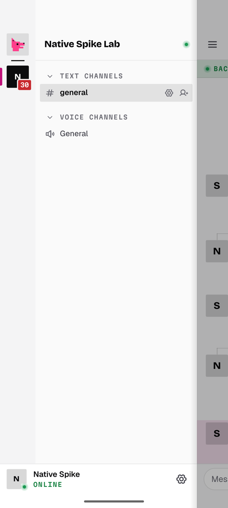
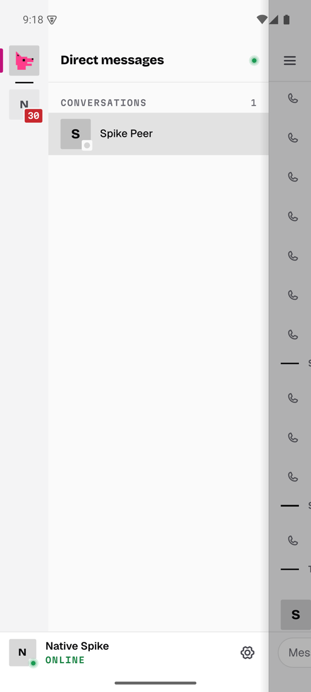
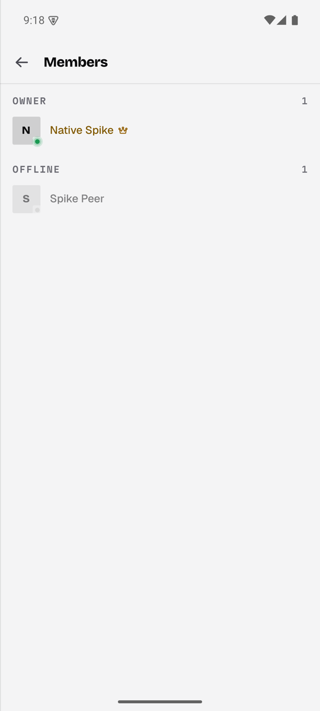
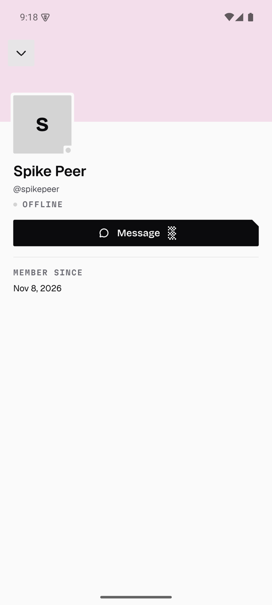
</p>
<p>
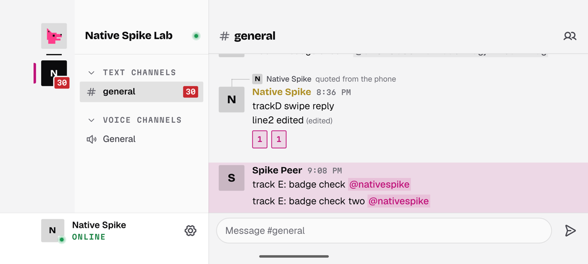
</p>

## Side by side (same emulator, same account, same channel)

Measured on the shared `Comet_API_35` emulator (x86_64, API 35, 60 Hz,
1080×2400) after a cold boot. The host had under 1 GB of RAM free, so the
emulator was partly paged out. Start times are therefore slow and noisy for
both apps alike; compare them with each other, not with a phone.
`#general` held 170 messages for the scroll test.

|                                    | Compose baseline                                                            | Qt Quick                                                                                |
| ---------------------------------- | --------------------------------------------------------------------------- | --------------------------------------------------------------------------------------- |
| Cold start (`am start -W`, 3 runs) | 10.1 s, 5.1 s, 3.4 s                                                        | 11.7 s, 3.3 s, 4.8 s (first frame 5.1 s, 1.8 s, 1.4 s)                                  |
| Snapshot read (cached content)     | 222–280 ms                                                                  | 7–75 ms                                                                                 |
| Scrolling `#general` (24 flings)   | 751 frames; jank 6.4%; frame time p50 18 ms, p90 23 ms, p95 32 ms (gfxinfo) | about 1,460 frames; swap interval p50 16.6 ms, p95 18–19 ms; 8 frames over 34 ms (0.5%) |
| Memory after scrolling (PSS)       | 60 MB                                                                       | 148 MB (87 MB before opening the channel)                                               |
| APK, x86_64                        | 19.5 MB (12.6 MB gzipped), R8 off                                           | 57.1 MB                                                                                 |
| APK, arm64                         | core 8.7 MB (4.0 MB gzipped) plus Compose; about 12 MB gzipped              | **55.7 MB, 20.5 MB gzipped** (was 61.5 MB, 22.3 MB; "Size" below)                       |

The two scroll columns measure different things. gfxinfo times each
frame's work on the UI and render threads; Qt's column is the interval
between swaps on its render thread, which gfxinfo cannot see. Both say the
same thing: neither list drops frames in a steady fling. Qt holds vsync
with a few spikes when new rows are created.

<p>
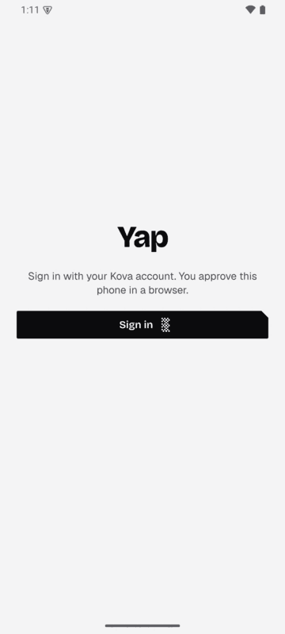
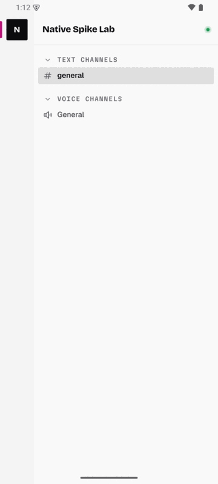
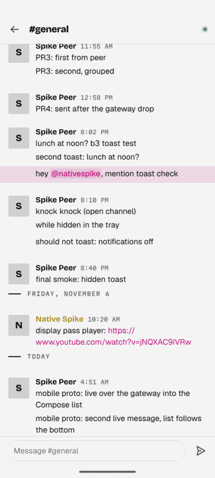
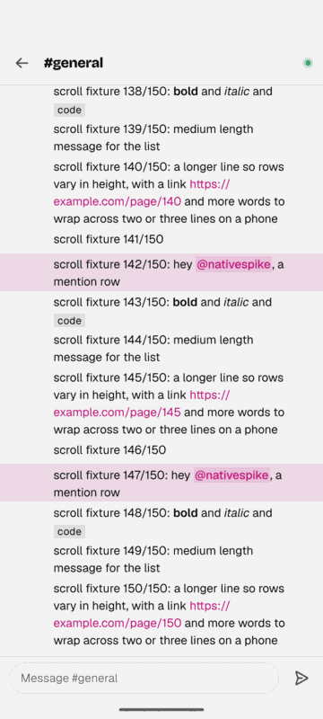
</p>
<p>
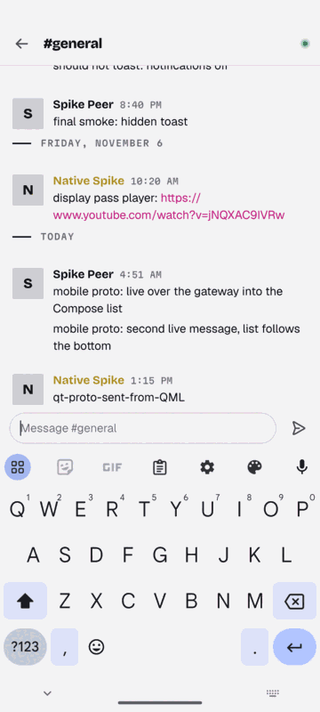
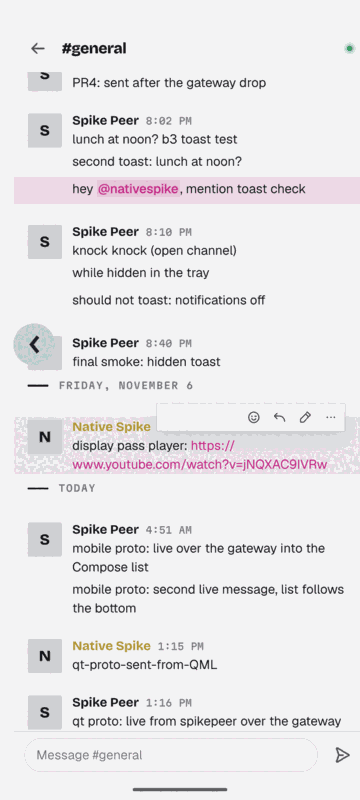
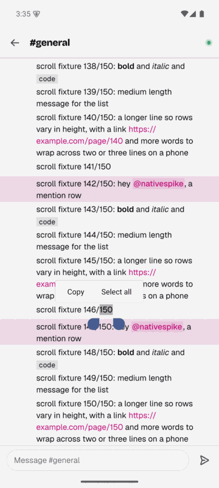
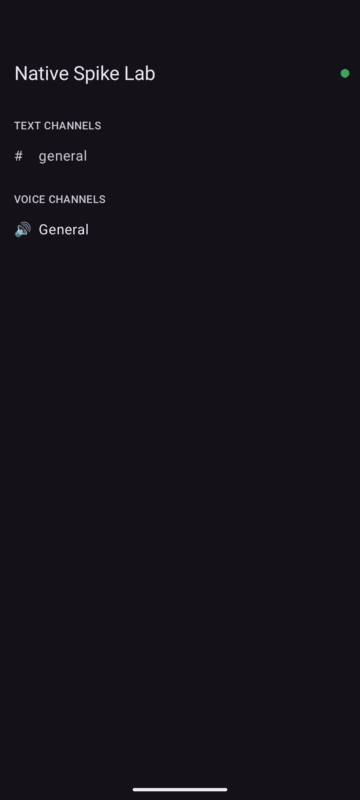
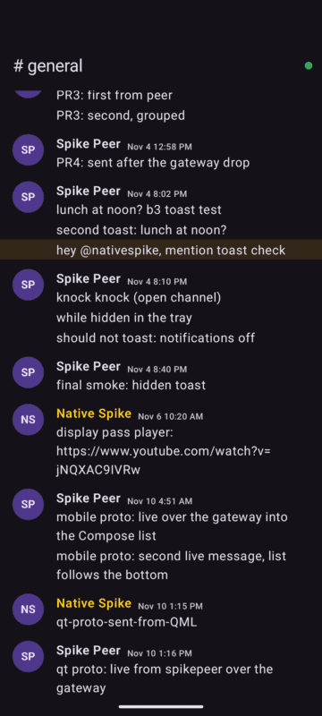
</p>
<p>
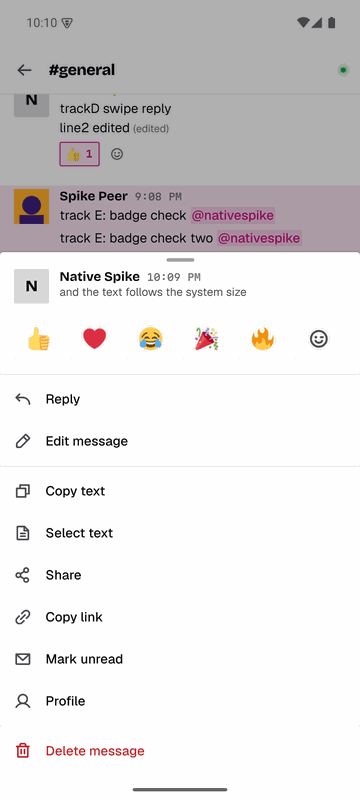
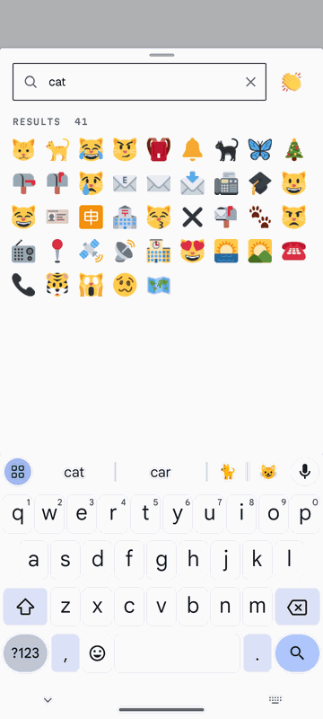
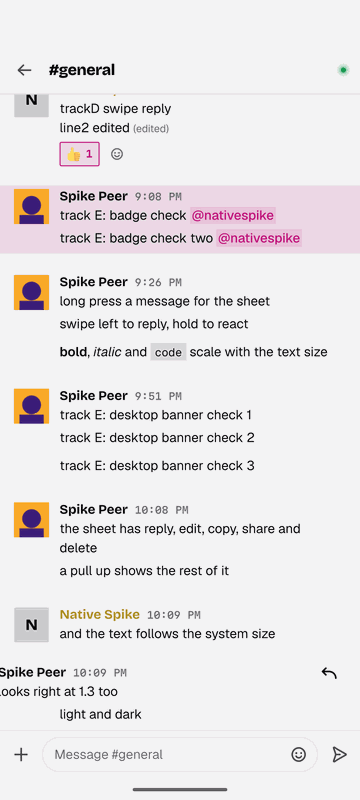
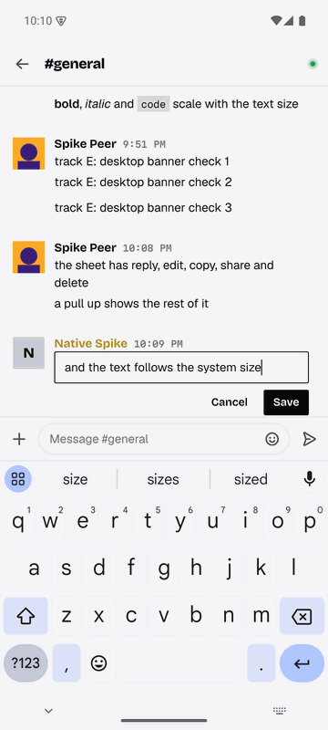
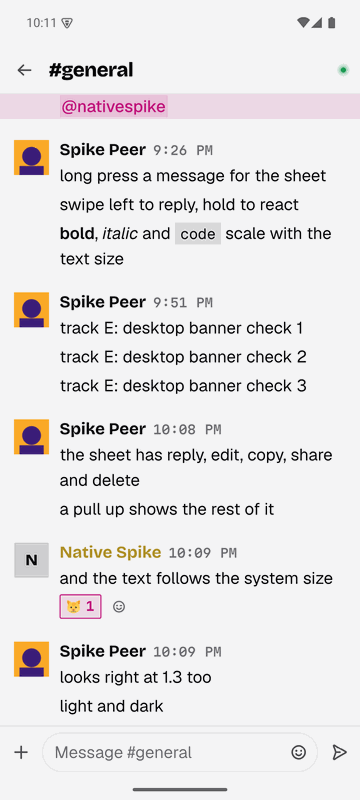
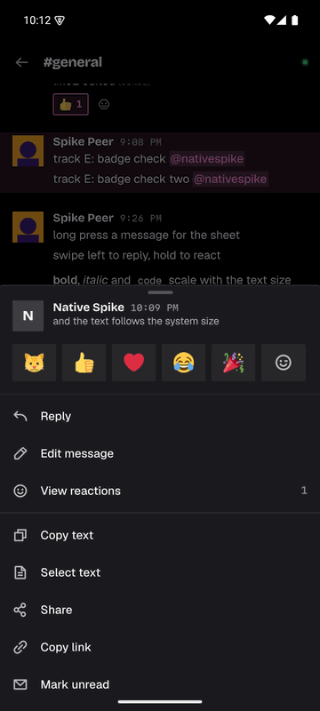
</p>

### What feels off

Qt Quick:

1. A grouped message shows no time: the desktop shows it in the gutter on
   hover, and the phone has no hover. The sheet's header names it.
2. The long press is a fixed 400 ms (Android's default), not the system's
   "Touch & hold delay" setting.
3. Copying says nothing by itself. Android 13 and later show their own
   clipboard chip; before that there is no confirmation (no toast host yet).
4. The text size is read when the app comes back to the front, not while
   it is open.
5. A sheet taller than 80 % of the window rests at 60 % and runs under the
   gesture bar there: its last row is reachable only after a pull up. (A
   sheet that fits, the message sheet included, rests at its full height.)
6. Swipe to reply takes leftward drags that start on a message. A pager or
   a drawer behind the chat gets the rightward ones and the header's.
7. The first cold start is slow (qmlcachegen compiles the QML to C++ but
   Qt's own libraries load as 15 shared objects); the second and later are
   comparable to Compose.

Compose baseline:

1. Hard-coded dark mode, and dark status-bar icons on the dark background.
2. Markdown shows as source: the core's `html` is Qt rich text, which
   Compose cannot draw without a new renderer.
3. Every row is re-implemented, so it drifts from the desktop's design
   (generic avatars, Material type, no Yap fonts or tokens).
4. Read-only: no composer.

## Size: what is in the APK, and what can go

arm64, release, shared Qt libraries from download.qt.io (`qt/build.sh`,
signed by `qt/sign.sh`), measured 2026-11-10 before the shared `yap-ui`
crate landed (with it, CI's arm64 APK is 57.9 MB, 21.2 MB gzipped; the
`qt-android` job prints the per-library list). Libraries are stored
uncompressed in the APK (page-aligned, loaded in place), so the APK is
about the sum of its parts; gzip -9 of the whole APK stands in for the
download size.

| Part                                                                                                   | Before  | After   |
| ------------------------------------------------------------------------------------------------------ | ------- | ------- |
| `libyapqt` (the core, the bridge, the QML compiled to C++, cxx-qt, AnimatedPicture)                    | 14.7 MB | 14.4 MB |
| Qt Gui, Quick, Core, Qml                                                                               | 27.7 MB | 27.7 MB |
| Qt QuickTemplates2, QuickControls2 (Basic), Network, QmlModels, Svg, OpenGL, QuickShapes, QuickEffects | 10.2 MB | 10.2 MB |
| Plugins: android platform, gif/jpeg/webp/svg (before: also the OpenSSL TLS backend and offscreen)      | 1.9 MB  | 1.5 MB  |
| QML plugin stubs (`libqml_*`)                                                                          | 0.1 MB  | 0.1 MB  |
| `libc++_shared`                                                                                        | 1.3 MB  | 1.3 MB  |
| `classes.dex` (Qt's Java, the shim, AndroidX)                                                          | 5.3 MB  | 0.3 MB  |
| **APK**                                                                                                | 61.5 MB | 55.7 MB |
| **APK, gzip -9**                                                                                       | 22.3 MB | 20.5 MB |

What made the difference:

- **R8** (`qt/android/build.gradle`, Qt 6.11's template plus a release
  `minifyEnabled`/`shrinkResources`; `proguard-rules.pro` keeps
  `org.qtproject.qt.android.**` and `dev.yap.**`, which C++ reaches over
  JNI by name, and the AndroidX font and `FileProvider` calls Qt's platform
  plugin makes the same way): the dex was mostly Kotlin, kotlinx coroutines
  and AndroidX that `androidx.core` pulls in. 5.3 MB to 0.30 MB.
- **Two plugins dropped** (`qt_import_plugins(... EXCLUDE ...)`): the
  offscreen platform plugin and the OpenSSL TLS backend (Qt for Android
  ships no libssl, so it never loaded). 0.4 MB.
- **Identical code folding** for `libyapqt` (`-Wl,--icf=all`): 0.33 MB.
  `--icf=safe` folded nothing. `--gc-sections` was already on (the NDK's
  toolchain file), and Gradle strips the libraries it packages.

Modules used: Core, Gui, Network, Qml (QmlModels, QmlMeta, WorkerScript),
Quick, QuickControls2 with the Basic style, QuickTemplates2, QuickEffects
(MultiEffect for round avatars), QuickShapes, Svg, OpenGL.

Dropped already (`qt_import_plugins` in `qt/CMakeLists.txt`): the QML
debugger and profiler services, the TIFF/ICO/ICNS/TGA/WBMP decoders, icon
engines, network information, offscreen, the OpenSSL backend. Not linked
at all: Multimedia, WebView, Widgets, Quick 3D, the other Controls styles,
SQL.

Next savings, not measured yet:

- the desktop's bytecode-only QML (`patches/qt-build-utils`; desktop pass 5
  saved 2.8 MiB);
- a static Qt for Android with LTO. That needs Qt built from source for
  Android (hours, about 15 GB). Not attempted here, so static vs shared is
  open.

**Voice adds 14.4 MB** (arm64, release, measured 2026-11-11 with one
toolchain on main at `bf81ba6f` and on the voice branch): the APK goes
from 61.3 MB to 75.8 MB, and gzip -9 of it from 22.2 MB to 28.7 MB.
`libyapqt` grows from 19.1 MB to 33.2 MB (libwebrtc, with its codecs, and
the call), `classes.dex` from 0.93 MB to 1.32 MB (libwebrtc's Java side,
kept whole for JNI). Not tried yet: keeping only the JNI entry points the
audio device module and the codec factories use (the link keeps all 224,
and with them the Java API's native side), and a WebRTC built without the
video codecs an audio-only phone never runs.

## Gaps found

- **HTTPS for Qt's own network loads (done).** `Image` and
  `AnimatedPicture` load avatars, server icons, attachments and GIFs
  through Qt Network, whose HTTPS needs OpenSSL on Android, which Qt does
  not ship (`qt/CMakeLists.txt` drops Qt's OpenSSL TLS plugin). The
  engine's `QQmlNetworkAccessManagerFactory` (`qt/cpp/rustnetwork.cpp`)
  answers every http(s) GET with a `QNetworkReply` fed by the core's
  rustls client (`qt/rust/src/http.rs`, its own two-thread runtime, bodies
  capped at 32 MiB); `qrc:`, `file:` and image providers stay Qt's. The
  session goes only to the API's private media (`media_needs_auth`, the
  desktop's rule, from `ViewUpdate::MediaAuth` in the mobile `Platform`),
  and reqwest drops it on a redirect to another host. The disk cache (the
  app's cache folder, 256 MiB) is done in the manager, since
  `QNetworkDiskCache` only plugs into Qt's own HTTP backend: Qt's load
  rules (fresh copies served, stale ones revalidated with
  `If-None-Match`/`If-Modified-Since`), and with no network the last copy
  is shown. Private media and redirected answers are never cached. Open:
  the cache is not emptied on sign-out (only public pictures are in it),
  and the API's avatars answer `max-age=0` with an ETag it does not honour
  (`200`, not `304`), so each avatar is fetched again per launch.
- **Exit.** Qt's Android exit path tears down the engine while the core's
  threads run (it ends in a SIGABRT on a render helper thread). Call
  `yap_mobile_flush` on going to the background (done) and leave by moving
  the task back, never by quitting the engine or letting the system finish
  the activity (see "Navigation": Back at the root).
- **Memory.** 156 MB PSS after a long scroll on the emulator (2026-11-11;
  native heap 73 MB, from 96 MB), of which about 18 MB is the emulator's GL
  pipe (`QemuPipeStream`), which a phone does not have. heapprofd on the
  build before that pass (a cold start, `#general`, 24 flings) put the
  native heap at: message rows and the other delegates 24 MB (a message row
  costs roughly 270 KB), decoded pictures 14 MB, the brand fonts 6 MB. Since
  then the fonts are read from the mapped resource (Qt copied each file onto
  the heap), `DisplayName` builds its 20 animation objects only for a name
  style that moves, and pictures are decoded at the size they are drawn.
  The chat list no longer reuses rows (below): after 20 flings 119 MB PSS
  (native heap 55 MB) against 131 MB (66 MB) with reuse in the same build
  and session; the pool kept rows scrolled past, and their decoded
  pictures, alive until they were handed out again. Keeping a third of a
  screen of rows built past each edge of the chat list, not a whole one, is
  not kept: with reuse it saved 10 MB, without it nothing (134 MB in that
  session) and a fling builds more rows (183 against 129). Next: the shared
  delegate's hover handlers, tooltips and loaders, which a phone never
  opens, behind `Theme.hoverUi` (with a desktop comparison).
- **The chat list's end.** Builds of the 2026-11-11 pass hung (the GUI
  thread at 100%, the process past 1 GB) when the open channel was picked
  again in the drawer with a message of pictures at the top of the screen.
  The list rebuilt itself round after round, and each round built the row's
  pictures again; with a GIF player built with its row that was a decoder
  and a first frame a round (the likely source of the memory: nothing
  queued to the GUI thread or marked for deletion is released while it does
  not return to its event loop). The player is still built only once its
  row has stood for 400 ms at its final size: a row built ahead of the
  scroll and dropped costs no fetch, and the player is never resized
  (attachments are private, so not in the disk cache: each size it is drawn
  at is a download). Three things made the loop, and `ChatPage` now does
  none of them:
  - It called `positionViewAtEnd()` from the list's `contentHeight` and
    `count` signals. Those fire inside the list's refill, which does not
    nest: with the last row out of the cache buffer, the call released
    every built row and built none. The end is now followed once per turn
    of the event loop (`settle`, the desktop's `reflow`).
  - Rows were reused. A pooled row handed to another message keeps its old
    height until its columns lay out again, a pass after the list placed
    it: a row of pictures placed short at the top of the screen grew by
    hundreds of pixels, pushed the last rows out of the buffer, the list was
    rebuilt around its end, and the row came back from the pool short
    again. `reuseItems` is off for this list, as on the desktop; a new row
    has its height when it is placed.
  - A reset of the list (the open channel picked again) did not land it
    again. It does now (`onModelReset`), as on the desktop.

## Licensing: owner decisions

These are open questions for the owner, written up here, not decided:

1. **GPL-3.0 and the App Store.** Yap's own crates are GPL-3.0-only. GPL
   code on Apple's store is widely considered incompatible with Apple's
   terms (VLC was removed in 2011). Every third-party crate in `deny.toml`
   is permissive or MPL-2.0, so the owner, who holds the copyright, can add
   an App Store exception or dual-license the mobile build. This applies to
   every option, including Compose/SwiftUI.
2. **Qt's LGPL-3 on iOS.** The LGPL requires that users can relink the app
   against a modified Qt. Three routes:
   - **dynamic Qt frameworks**: users swap the framework. Qt's official iOS
     packages are static, so this needs Qt built from source as frameworks,
     which is not a configuration Qt supports or tests;
   - **relinkable object files**: ship the static build plus the app's
     object files and a link script on request. This is the common LGPL
     answer for iOS, and it works with the store's signing because the
     user relinks for their own device;
   - **a commercial Qt licence** for the mobile apps, which removes both
     questions (a per-developer subscription).
3. **Qt on Android.** Shared Qt libraries under the LGPL are the plain case
   (the `.so` files are replaceable). Nothing to decide unless a static
   build is chosen for size, which brings back the relinking question.

## The prototypes

```
desktop-native/mobile/
├── common/platform.rs   rustls client and the logcat bridge, used by both
├── qt/                  Qt Quick app (dev.yap.app)
│   ├── rust/            cxx-qt crate yap_mobile_qt: the mobile Platform
│   │                    (client.rs) and the com.yap.mobile module; links yap-ui
│   │   └── qml/         mobile shell, pager and pages; seams/ (Yap.Platform types)
│   ├── vault/           crate yap-mobile-vault: the sealed session file, migration
│   ├── cpp/             main.cpp, native.* (the platform shim), push.cpp, keystore.cpp
│   ├── android/         manifest, NativeShim.java, TokenVault.java, push/ (FCM), icon and splash,
│   │                    build.gradle (R8, Firebase)
│   ├── build.sh         Qt + cxx-qt-cmake → APK (Android) or .app (iOS simulator)
│   ├── fetch-qt.ps1     Qt 6.11.3 from download.qt.io, pinned by qt-sdk.lock.json
│   ├── VERSION          the app version (x.y.z), read by CMake and CI
│   ├── sign.sh          zipalign + apksigner (v2/v3), .sha256
│   ├── smoke.sh         install, cold start, wait for the first frame
│   └── ci/              the public CI debug keystore (not for release)
├── rust/ android/ build.sh    the Compose baseline (UniFFI)
└── docs/                screenshots
```

### The chat page: composer, attachments, image viewer

`MobileComposer.qml`, `UploadTray.qml` and `ImageViewerPage.qml`, on the
shared `Chat` API (no core changes):

- **Reply.** `ChatPage.startReply(messageId, author, text)` shows the reply
  bar (the author, the text on one line, Cancel) and opens the keyboard; the
  send carries `reply_to_id`. The long-press sheet and swipe to reply call it.
- **Mentions.** Typing `@sp` asks `Chat.queryMentions`; up to five members
  float above the composer and a tap puts `@username ` in. The keyboard's
  word in progress (preedit) counts, so suggestions follow Gboard's
  composing text, and it is committed before the insert.
- **Emoji.** A row of the recents (`Emoji.quick`) and common emoji as text,
  inserted at the caret. The full picker is the shared `EmojiSheet` once it
  lands; server emoji need the desktop's placeholder handling.
- **Attachments.** `+` opens the photo picker (`Native.pickMedia`). The tray
  shows each file's picture, progress and size; remove or cancel, mark
  sensitive, tap a failed tile to retry (its reason shows in the notice
  line), tap a finished picture to view it. Files over the limit stay as the
  core's too-big cards (they are not copied: a sparse file of their size
  stands in). Sending works with text, pictures or both.
- **The rest.** Send is enabled by typed text (preedit included) or a
  finished upload; typing pings go at most every 3 s (the core sends every
  one it is asked to); the field grows to five lines; each channel keeps its
  unsent text and reply while the app runs (`Drafts`, cleared on sign-out).
- **Viewer.** A tap on a message's picture opens it full screen over the
  chat: pinch or double-tap to zoom, pan, swipe sideways between the
  message's pictures, swipe down or Back to close, a tap to show or hide the
  bar (close, `2 / 3`, the name, Share for the link).

Not done yet: a camera shot from the composer; video in the viewer; saving
to the gallery; sensitive pictures are not blurred in the viewer; on 13+ the
photo picker names files by their media id (`1000000302.jpg`), not the
original name; the status bar icons stay dark over the viewer in the light
theme until the shim can switch them (`Native.lightBars`); picked copies stay
in the app cache until the next start.

<p>
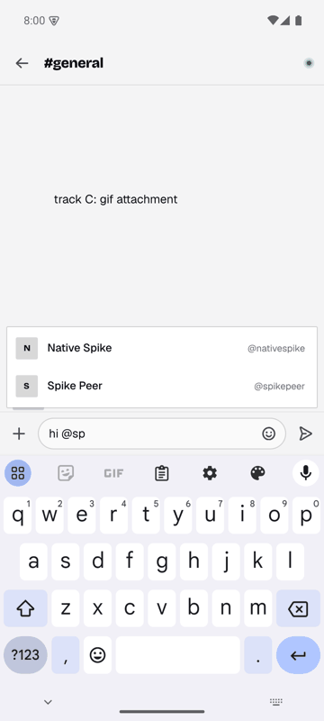
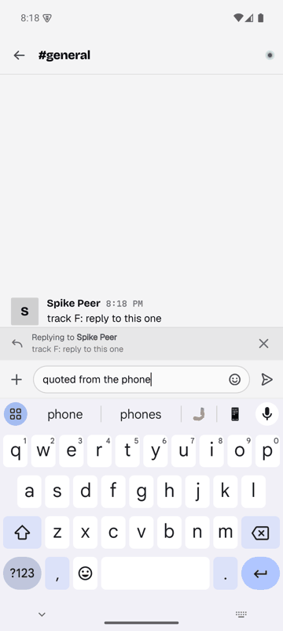
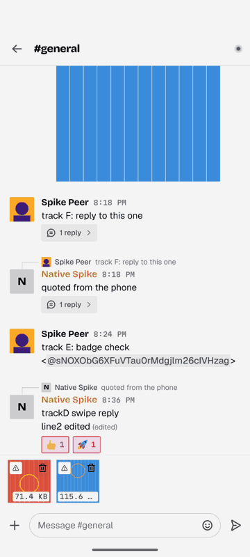
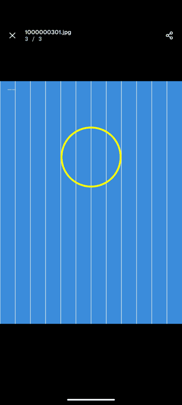
</p>

### Push notifications

The server's push path is the Expo app's (`/api/push-tokens`,
`src/services/push.service.ts`): the app registers its FCM token with
`push_format: "native"` and `app_variant: "qt"`, and the server sends
data-only pushes (`ralph: "2"`, `kind: message | read`) that the app draws.

- **Token.** At each start the shim asks FCM for the token
  (`push/PushShim.java`) and hands it to the core (`rust/src/push.rs`,
  `Command::RegisterPush`), which registers it once the session's `me` is
  known, and again for each account signed in later (a failed try again at
  the next gateway Ready). A rotated token
  (`onNewToken`) registers the same way, or, with the app killed, straight
  from Java with the stored session. Sign-out unregisters first
  (`DELETE /api/push-tokens`; the session's revoke waits for it, at most
  3 s).
- **Drawing** (`push/MessageNotifier.java`, a port of the Expo app's
  `MessageNotifier.kt`): one MessagingStyle notification per conversation,
  with the sender's avatar, the last eight messages and the brand accent,
  grouped under a summary, on the channels `dms`, `mentions` and `other`
  (the Expo app's ids). Each conversation gets a long-lived shortcut, so it
  is listed under Android 11+'s Conversations. A read push (`kind: read`,
  read on another device) takes the conversation's notification down.
- **Actions.** Reply (RemoteInput, an answer to the newest message) and Mark
  as read. With the app running they go into the core as the desktop's
  toast actions (`Command::ToastReply` only with the app in front,
  `ToastMarkRead`); otherwise the receiver calls the API, and a failed
  reply shows as "Not sent: ...", with the sealed session file the core
  keeps, opened with the same Keystore key ("The session token" below;
  its folder and the API's origin are handed over at each start,
  `PushStore`).
- **Tap.** The notification opens the app at its conversation: the intent
  carries the channel, server and (a DM's) person ids. `YapActivity` (Qt's
  activity) hands each fresh start's and `onNewIntent`'s tap to the shim,
  which keeps it until Qt is up (a task relaunched from Recents gets the tap
  before `main()` runs); a restored or from-Recents start's old intent is
  ignored. `Native.openRequested` / `takeOpenRequest()` give it to
  `Main.qml`, which calls `Nav.openChannel` (the core's `OpenChannel`,
  switching servers first; a DM the list does not have yet, as on a launch
  from the cache, opens when the list answers) once signed in, and slides
  the chat in.
- **In front.** `Native.activeConversation` is the conversation being read
  (`Main.qml` binds it to `Nav.activeChannelId` while the chat is on screen
  and the app is active): its pushes are not shown and its notification is
  taken down.
- **Permission.** `POST_NOTIFICATIONS` (API 33+) is asked for once, when
  the first conversation opens. `Native.notificationsEnabled` (read again
  whenever the app returns) and `Native.requestNotifications()` (the dialog
  while it can still show, else the app's notification settings) are for
  Settings.
- **Background.** `Session.setVisible(false)` also sends
  `Command::Suspend(true)`: a minute into the background the gateway
  closes (a call or a session still booting puts it off by another minute),
  and it reconnects (a Ready that refetches what is on screen) as soon as
  the app is back. The desktop never suspends.

Firebase is set up without the google-services Gradle plugin:
`android/build.gradle` reads the `google-services.json` that
`YAP_GOOGLE_SERVICES_JSON` names, takes the client for the application id,
and writes the string resources the plugin would (`google_app_id`,
`google_api_key`, `gcm_defaultSenderId`, `project_id`), from which
FirebaseInitProvider starts Firebase. The file holds API keys and stays out
of the repository; the release workflow decodes the
`QT_GOOGLE_SERVICES_JSON_BASE64` secret into the build folder. Without it
the APK builds and runs, with no pushes. Only `dev.yap.app` is registered in
the Firebase project the server's `FCM_SERVICE_ACCOUNT` sends from: CI's
`dev.yap.app.ci` builds have no Firebase configuration and no pushes
("Build and run the Qt app"); pushes are tested with local and release
builds.

### The session token

The core keeps the session token in `session.sealed` in the app's data
folder, sealed with AES-256-GCM under a key in the Android Keystore
(`qt/vault`, the `yap-mobile-vault` crate: the file, its migration and
failures; `android/src/dev/yap/qtproto/TokenVault.java`: the key, seal and
open; `cpp/keystore.cpp`: the JNI call from the core's blocking thread).
The push code opens the same file with the same key for a Reply with the
app killed (`PushStore` → `TokenVault.readToken`); it never writes it. Each
write goes to a temporary file that is synced and renamed over the old one,
so a reader sees one whole version. The desktop is unchanged (its
`Keyring`).

- **The key.** Made on the device at the first seal, a sign-in or a
  migration (alias
  `yap.session.v1`), never exportable, the Keystore choosing every IV. It
  needs no user authentication and no unlocked device: a notification's
  Reply sends with the app killed and the phone locked. It works whenever
  the app's own files can be read (after the first unlock since boot).
- **What it protects against.** A copy of the app's files leaving the device
  (a backup tool, a rooted phone's file copy, a forensic image) does not
  give the token away without this device's key; cloud backup and
  device-to-device transfer leave the files out anyway. It does not stop
  code running as the app (or as root) on the device, which can ask the
  Keystore to open the file as the app does.
- **Migration.** Earlier builds kept the token in plain text
  (`session.token`). The first start of this build seals it into
  `session.sealed`, then deletes the plain file (also when sealing fails:
  that run stays signed in, the next one asks to sign in). Until that start,
  a Reply with the app killed reads the plain file.
- **Failures sign out.** A sealed file that can never open (no key,
  another key, a key the Keystore invalidated, the file damaged) is deleted
  with its key, and the app shows the sign-in page; the next sign-in makes
  a new key. A Keystore that cannot be asked (any other exception; tried
  twice) signs out for that run only and keeps the file for the next
  start. A seal
  that fails gets a new key and one more try; if that fails too, nothing is
  kept (an older sealed token is deleted). Sign-out deletes the sealed and
  any plain file. Logs (`[session]` from the core, `yap-vault` from Java)
  name the step and the exception class, never the token.

### Settings and Friends

Both are pages of the stack (they slide in from the right), built on the
desktop's objects with phone list layouts:

- **Settings** (the account row at the drawer's foot): who is signed in,
  then numbered sections under 2px ink rules (the desktop's rule cards).
  _Status_: Online, Idle, Do not disturb, Invisible and the custom status
  line (`Session.setStatus`). _Appearance_: the core's seven themes as
  thumbnails (`Settings.chooseTheme`, kept in this device's
  `appearance.json`; "Use on all my devices" is `Settings.changeThemeSync`).
  A phone starts on Match system: `yap_mobile_init` seeds `system` before
  the core reads the file (the core's default is the desktop's `dark`), and
  `Main.qml` maps `system` to the light or dark mode, live. _Text size_: a
  factor (0.85, 1, 1.15, 1.3) over the system's font scale, kept in the
  app's QSettings (`Prefs.textFactor`); `Main.qml` binds
  `Theme.textScale` to `clamp(Native.fontScale * factor, 0.85, 2)`, and the
  section's sample is a message row at that size. _Notifications_: the
  switch shows `Native.notificationsEnabled`; while off, a tap is
  `Native.requestNotifications()` (Android's dialog while it still shows,
  else the app's notification settings); once on, only Android's settings
  turn them off, so the tap does nothing. _Devices_: the account's
  sessions (`Settings.loadSessions`); another device signs out after a
  confirm (`Extras.revokeSession`). The server lists only the current
  session today (`GET /api/sessions` returns it alone, with `activity:
null`), so the row reads "Desktop · Desktop client", the client's
  fallback title, on a phone too, and other devices never show. _About_: the APK's version name, the
  licence and the privacy policy. _Sign out_ asks first, in place.
- **Friends** (the first row of Home's pane, with the incoming count): the
  desktop's `Friends` object behind four tabs (Online, All, Pending,
  Blocked; the page opens on Pending while requests wait) and Add friend by
  username. A friend's row opens the DM; anyone else's opens the profile.
  Requests carry Accept and Ignore or Cancel, a friend's more key opens
  Profile, Remove and Block in the row, a blocked row has Unblock. Remove,
  Ignore, Cancel and Block confirm in place (`InlineConfirm`, the desktop's
  ConfirmStrip at phone size), where the request's progress and any
  failure show; `ConfirmSheet` closes before the request answers.

`SettingSwitch` and `TabRule` moved from the desktop's components into
`Yap.Ui` for these pages; the desktop uses the same files.

Verified on the emulator against the test accounts: Do not disturb and a
custom status set on the phone and read back as the peer from
`/api/friends`; themes switched live (Midnight, back to Match system) and
the choice and the Larger factor kept across a force-stop; a request from
the peer arriving on Pending, accepted on the phone (the peer's list showed
the friendship), removed after the confirm, then a request sent from the
phone's Add friend and accepted by the peer arriving live; Message opening
the DM; Block from a friend's row (the account's list showed the block)
and Unblock from the Blocked tab; Sign out returning to sign-in and a new
device code signing in again; Larger scaling the chat's names, messages
and times to 1.3 (the system at 1.0), and the status bar's icons turning
light on Midnight under a light system; Notifications off on a fresh
install, Allow in Android's dialog turning it on, and after a revoke and a
second refusal the tap opening the app's notification settings, where
turning them on showed on return. Not verified: signing out another device
(the server lists one session), and the licence links opening a browser.

<p>
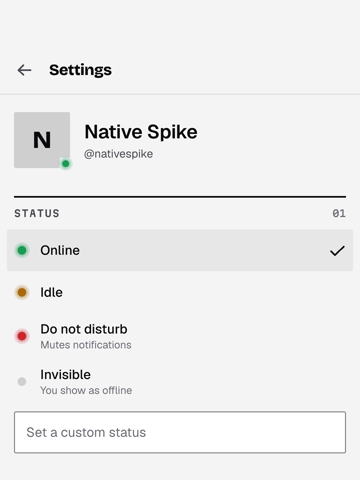
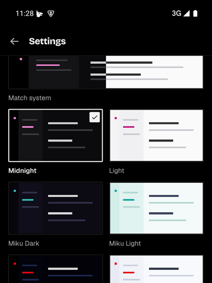
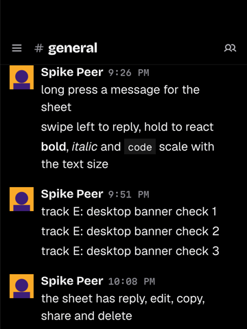
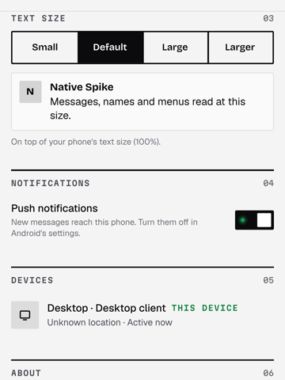
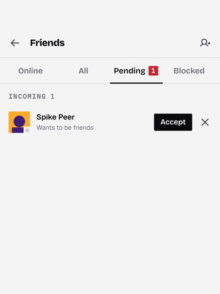
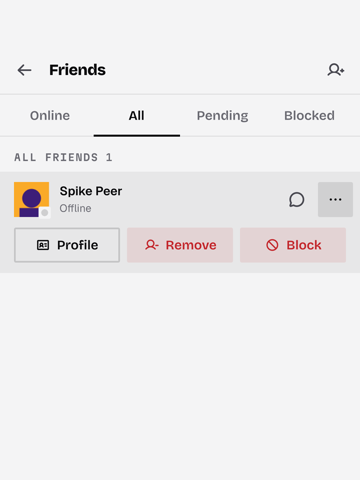
</p>

### Voice calls

A voice channel's row in the drawer joins it. The call is the desktop's:
`yap-voice` (the call state machine, the room and voice sockets, the SFU
client, libwebrtc media) behind the phone's `Realtime::spawn_voice`,
through the store driver both apps now run (`yap_voice::call`, "Core
refactors"). Android only: the iOS build stays a compile and link check
without libwebrtc. What is the phone's own:

- **Media.** LiveKit's prebuilt WebRTC for Android (`webrtc-sys` 0.3.52 and
  `libwebrtc` 0.3.55, the desktop's pins, with the desktop's patches:
  `qt/rust/Cargo.toml` patches in the copies `patches/vendor.ps1` makes,
  which `build.sh` runs; the Media Foundation and D3D11 patches in them
  build only for Windows). Audio goes through libwebrtc's own Android
  device module, `AudioRecord` on the `VOICE_COMMUNICATION` source and
  `AudioTrack`, with the platform's echo canceller and noise suppressor
  and WebRTC's processing. That is the path the desktop keeps behind
  `YAP_ADM_AUDIO=1`, so the phone has no RNNoise and no per-person panning
  (spatial audio is heard flat), and one mixed playout. The voice settings
  are the defaults: the phone has no page for the output and per-person
  volumes, sensitivity or processing yet. The soundboard's and Listen
  Together's audio are not played (`yap-audio` is not in the app). No
  camera, screen share or remote video yet: the phone asks for no video,
  so none is pulled.
- **Start-up.** libwebrtc needs the process's `JavaVM`, the application
  context and its Java side (`livekit.org.webrtc.*`, in the prebuilt's
  `libwebrtc.jar`). `VoiceShim.install` calls its `nativeInit` at start,
  which hands both to `yap_voice::android::init`; it has to come from a
  thread Java called into, because libwebrtc looks its classes up with
  `FindClass` there. `yap-voice`'s build script writes what the packaging
  needs into the folder `YAP_WEBRTC_EXPORT_DIR` names (CMake sets it): the
  jar, which CMake copies to where Gradle picks up jars, and
  `webrtc_jni.rsp`, a linker response file with `--undefined` for each of
  the 224 `Java_livekit_org_webrtc_*` entry points. Java binds to those by
  name in `libyapqt`, and nothing native refers to them, so the link would
  drop them (webrtc-sys asks for the same with `cargo:rustc-link-arg`,
  which does not reach a staticlib linked by CMake). R8 keeps
  `livekit.org.**` (the classes and jni_zero's glue under it).
- **Permission.** `RECORD_AUDIO`, asked at the first join
  (`Native.requestMicrophone`). Refused, a sheet says what it is for and
  opens the app's page in the system settings (after a second refusal
  Android no longer shows its dialog).
- **Background.** Android keeps a backgrounded app's mic only behind a
  foreground service of type microphone. `VoiceService` is that, with the
  ongoing notification: the channel, how long the call has run, Mute or
  Unmute and Leave. It holds no call state, and neither direction goes
  through Qt's thread: the core tells the shim from its own thread that a
  call's task started or that the last one ended
  (`yap_mobile_call_active`; the service stops 1.2 s after, so a call the
  room restarts or moves keeps it), and the notification's actions go from
  the shim straight to the core's command channel. The service starts only with the permission and from the
  foreground (a join is a tap), which Android 14 requires of a microphone
  service. Swiping the task away ends the call: Qt ends the process when
  its activity is destroyed, so the service's `onTaskRemoved` and the
  activity's `onDestroy` first tell the room we left (the desktop's
  disconnect beacon, up to 800 ms on the main thread). The gateway stays up
  under a call (the core's background suspend skips it). A call the process
  died in without that is reported as left at the next sign-in (the
  desktop's stale beacon).
- **Qt in the background.** Qt for Android stops its event loops while the
  app is suspended unless the activity's `android.app.background_running`
  is `true` (`QtLoader` turns it into `QT_BLOCK_EVENT_LOOPS_WHEN_SUSPENDED`
  at start, so it cannot be switched on for a call only). The core's view
  updates wait for the Qt thread in one list (yap-ui's `Session::start`),
  and a call keeps them coming: the roster and the tree change with every
  talk LED. Measured on the emulator over a call left in the background
  with the screen off for 10 minutes, the peer's tone toggling its LED:
  11,370 updates queued, the app's PSS up 8.8 MB (148.9 to 157.8 MB), and
  1.06 s on the Qt thread applying them on return. The manifest now sets
  it. The same 10 minutes then queue nothing (no drain reached the 500
  updates from which the bridge logs a backlog) and return without the
  stall; PSS went from 149.7 to 151.3 MB; nothing is drawn meanwhile (the
  window is not exposed; no frame was swapped). `Main.qml` holds
  `Theme.reducedMotion` while the app is suspended, so a talk LED's fade
  does not tick the animation timer for frames nobody draws. The process
  used 259 s of CPU over those 10 minutes against 247 s with the loops
  stopped (the emulator's software audio is most of both; 267 s before the
  motion hold). With no call, 90 s after going to the background, it used
  0.06 s in a minute.
- **Audio session.** `CallAudio`, for as long as the service: the
  communication mode, transient audio focus, and the route. An
  interruption deafens the call through the core and its end undeafens it,
  unless the user changed it meanwhile; a call that ends interrupted takes
  the deafen back, so the next one does not start with it. Interrupted is a
  transient focus loss (a phone call, an alarm, the assistant) or, on
  Android 12+, the telephony audio mode, which still tells when focus no
  longer does. A focus loss for good (music started) leaves the call
  alone; one that follows a transient loss, or a request refused at the
  start, asks again every 2 s until the phone is free.
  Routes are the speaker, the earpiece, a wired headset and a Bluetooth
  one: `AudioManager.setCommunicationDevice` on Android 12+, the
  speakerphone switch and Bluetooth SCO before. Automatic is Bluetooth,
  then a wired headset, then the speaker; a headset that arrives takes the
  call, and a pick holds while its device is there. The earpiece holds the
  proximity sensor's screen lock. `BLUETOOTH_CONNECT` is not asked for:
  these APIs route to a paired headset without it.
- **UI.** `CallPage`, a page of the stack: the channel, the call's state as
  an LED word with the link quality and round trip beside it, everyone in
  the call as rows on `VoiceRosterModel` (the square avatar with the 2px
  talk ring, the name, mute and deafen glyphs, the talk LED), a line when
  audio stopped flowing one way or the call failed, and the dock: mic,
  deafen, the route (a sheet of `Native.audioRoutes`) and Leave. Back
  leaves the page, not the call. `CallBar`, above the account row in the
  drawer while a call is up: the state and the channel, a tap opens the
  page. It carries no controls (one dock). The tree's voice rows are the
  desktop's (`TreeRow`), with the occupants and their LEDs. Mute, deafen
  and the route tick (`Native.haptic`).

Verified on the emulator (API 35, x86_64) as Native Spike in Native Spike
Lab's General, against a headless Chromium as Spike Peer on the web client
with a fake microphone (a tone):

- the system's microphone dialog at the first join, the sheet after Don't
  allow, and the join after While using the app;
- both in each other's roster; audio both ways by the numbers: the phone's
  log showed the peer's track arriving and decoding (`in[1]` bytes rising,
  level up to 1.0) and its own leaving (`out[0]` bytes rising), and the
  peer's `inbound-rtp` for the phone's track rose alongside. The
  emulator's microphone is silent (level 0), so nobody heard the phone, and
  nothing was listened to by ear;
- the peer's talk ring and LED following its tone on the call page and in
  the tree. The emulator drew 9 frames a second (the host was building),
  and the 60 and 220 ms fades visibly trailed the state at that rate;
- mute and deafen from the dock reaching the peer's view of the room
  (`self_mute`, `self_deaf`), the phone's `out[0]` standing still while
  muted and its inbound level at 0 while deafened;
- Home, then the screen off for 89 s (past the 60 s suspend grace): the
  service in the foreground with type microphone, the notification up, and
  both byte counts still rising;
- Mute from the notification with the app in the background (the peer saw
  it, the notification turned to Muted and Unmute), then Leave from it:
  the call left, the peer's list dropped the phone, the service and the
  notification went;
- joining again straight away (no close code 4010), and Leave from the
  dock;
- an incoming phone call from the emulator's console (`gsm call`): while it
  rang (telecom held transient focus and the mode was the ringtone's) the
  peer saw the phone deafened and muted, and after `gsm cancel` neither,
  with the inbound level back;
- the task removed during a call (`am stack remove`, what a swipe in
  Recents does; adb's swipe did not move the card): the beacon went out,
  the peer's list dropped the phone within 3 s, and the process ended with
  no service or notification left. Before the service stopped itself here,
  Android 15 started the process again for it and kept the notification
  up.

Not verified: any route but the speaker (the emulator lists one, so the
route key stays off), Bluetooth and the earpiece's proximity lock; a phone
call answered and held, or one that arrives after another app took focus
for good; a restart or move of a call while in the background; a leave
and a join within the service's 1.2 s; Android before 15; a real device
(arm64 was built before the last Java and QML fixes and not run); a
second phone participant; a call in the background for longer than 10
minutes.

<p>
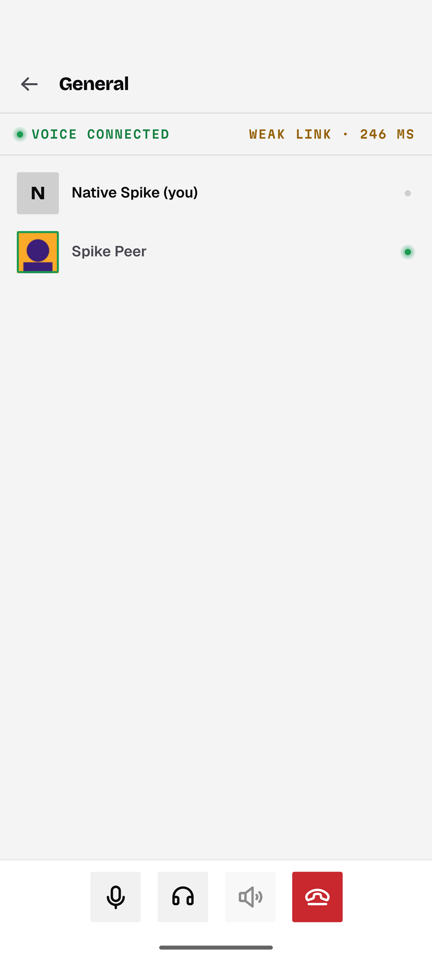
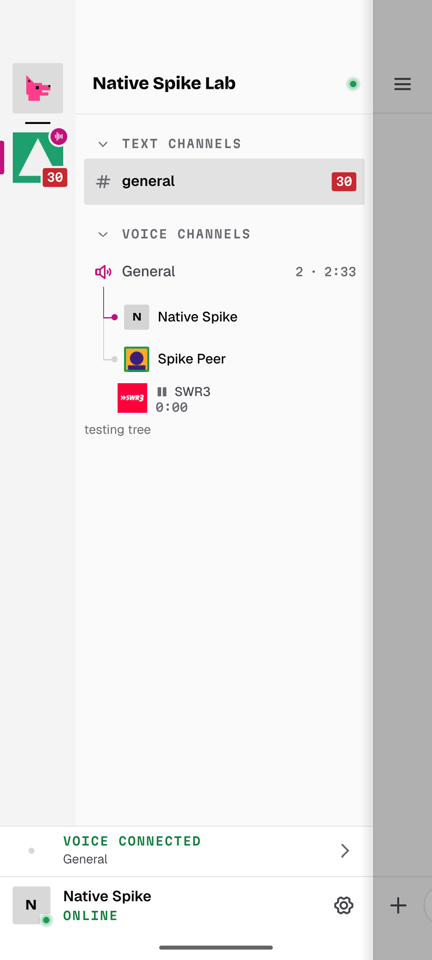
</p>

Next: remote video and shares on the call page (the desktop's
`VideoOutput` seam takes I420 frames; the phone needs a surface for them),
the camera, the in-call bar over the chat, DM calls and their ring, a
landing that shows who is in a channel before joining, the phone's own
audio path (RNNoise, panning, the soundboard), and iOS (AVAudioSession and
CallKit in place of the service).

### Build and run the Qt app

Needs:

- Qt 6.11.3: the target Qt (Android, one prefix per ABI, or iOS) and a
  desktop Qt 6.11.3 for the host tools (`QT_HOST_PATH`). `qt/fetch-qt.ps1`
  downloads exactly the archives `qt/qt-sdk.lock.json` names from
  download.qt.io and checks each one's SHA-256; `-Refresh` re-pins them from
  the repository's `Updates.xml` and the `.sha256` files download.qt.io
  publishes next to each archive. Sets: `android-x86_64`,
  `android-arm64_v8a`, `host-linux`, `host-mac`, `ios` (qtbase,
  qtdeclarative, qtsvg, qtimageformats, and ICU on Linux). On Windows the
  host is the custom static Qt in `tools/toolchain.lock.json`;
- the Android SDK, NDK r27c (27.2.12479018, the one Qt 6.11.3 for Android
  was built with; `build.sh` takes `$ANDROID_NDK_ROOT` or the SDK's
  `ndk/27.2.12479018`, and NDK 27.1 also works), JDK 17+, Ninja, 7-Zip,
  PowerShell 7, and Rust with the Android targets;
- for voice, the cargo registry's `webrtc-sys` and `libwebrtc` at the
  desktop's pins (`patches/vendor.ps1`, which `build.sh` runs, fetches and
  patches them into `rust/vendor`), and network for the first build of an
  ABI: webrtc-sys downloads LiveKit's prebuilt WebRTC for it (about 150 MB,
  700 MB unpacked, kept in cargo's target folder under the build tree).

```sh
pwsh desktop-native/mobile/qt/fetch-qt.ps1 -Dest $YAPM/qt -Set android-x86_64   # + host-linux off Windows
export QT_HOST_PATH=<desktop Qt 6.11.3> ANDROID_SDK_ROOT=<sdk>
YAPM=<a build folder off the system drive>   bash desktop-native/mobile/qt/build.sh x86_64 Release   # or arm64-v8a; -D... go to CMake
bash desktop-native/mobile/qt/sign.sh <the unsigned APK it prints> yap-qt.apk   # debug keystore by default
adb install -r yap-qt.apk
adb logcat -s yap-core default                             # core log, QML warnings, [frames]
```

`build.sh` points the downloaded target Qt's `qmake` wrapper (`qmake.bat`
on Windows, a shell wrapper elsewhere) and `target_qt.conf` at
`QT_HOST_PATH`, as aqtinstall does. Gradle's cache and the build tree go
under `$YAPM`; the target Qt defaults to `$YAPM/qt/<set dir>`
(`QT_TARGET_ROOT` overrides it). A rebuild in the same tree keeps libraries
androiddeployqt copied before, so a plugin dropped from the build stays in
the APK until `android-build/libs` is cleared.

Packaging, from CMake cache variables: `YAP_ANDROID_APP_ID` (default
`dev.yap.app`; also the Gradle namespace and the iOS bundle id; CI builds
`dev.yap.app.ci`), `YAP_ANDROID_APP_NAME` (the launcher label, default
"Yap"; CI's "Yap CI"), `YAP_ANDROID_VERSION_CODE` (1) and `YAP_ANDROID_VERSION_NAME` (`qt/VERSION`);
`YAP_ANDROID_COMPILE_SDK` and `YAP_ANDROID_BUILD_TOOLS` pin the SDK
platform and build tools (default: the newest installed). The manifest has
no `package` attribute. The launcher icon is adaptive, with a
monochrome layer for themed icons; the splash is ply-0 (light `#f4f4f5`,
dark `#000000`) with the mark: the system splash on Android 12+, the
window background before, then Qt's sticky splash, which `main.cpp` fades
out at the first frame.

`build.sh ios-simulator Release` configures the same project with Qt for
iOS and builds an unsigned simulator `.app` (x86_64: Qt's iOS libraries
have arm64 device and x86_64 simulator slices only). It is a compile and
link check; nothing runs it.

### Build and run the Compose baseline

```sh
CARGO_TARGET_DIR=<off the system drive> bash desktop-native/mobile/build.sh x86_64 release
adb install -r desktop-native/mobile/android/app/build/outputs/apk/release/app-release.apk
```

Sign-in in both shows a device code. Open the link in any signed-in
browser, or approve it with a test account's session:

```
POST https://<kova>/api/pub/apps/<publishable key>/device/lookup   {"userCode": "..."}
POST https://<kova>/api/pub/apps/<publishable key>/device/approve  {"userCode": "..."}
     Authorization: Bearer <session>, Origin: <yap web origin>
```

CI (`.github/workflows/desktop-native-mobile.yml`) builds the Compose
baseline's APK on Ubuntu, and on macOS cross-compiles the core for iOS and
type-checks its Swift bindings. For the Qt app, `qt-android` builds the
x86_64 and arm64-v8a APKs on Ubuntu with the pinned Qt (archives cached by
the lock's hash) and NDK r27c, signs them with the public CI debug key
(`qt/ci/debug.keystore`, so one run's APK installs over another's; never a
release key), and uploads each APK with its `.sha256` (14 days; version
code `run * 10 + 2` for arm64, `+ 4` for x86_64, version name
`<qt/VERSION>-ci.<run>+<commit built>`). Anyone can sign with that key, so
CI's APKs are a separate app: application id `dev.yap.app.ci`, label "Yap
CI", and no push notifications (no Firebase configuration; the Firebase
project knows `dev.yap.app` only). A CI APK installs beside a tester's
release build, and nothing signed with the public key can update the
release app. Before building, the x86_64 job runs the session vault's tests
(`cargo test` in `qt/vault`). `qt-android-smoke` cold-starts the x86_64 APK
(`YAP_ANDROID_APP_ID=dev.yap.app.ci`) on an API 35 emulator and fails unless it logs `[startup] first frame`
(`qt/smoke.sh`, which also works against a local emulator; it checks
start-up only, not sign-in). `qt-ios` builds the simulator `.app` on macOS when
`mobile/qt` or the workflow changes, by hand, and weekly. Each job runs only
when its own inputs change.

### Releases

Tester builds of the Qt app come from
`.github/workflows/qt-android-release.yml`, signed with the app's own
release key (not the Expo app's key, and not the public CI key). Each run
publishes a **draft** pre-release, "Yap for Android (Qt) <version>", with
`yap-qt-<version>-arm64-v8a.apk` (phones), `yap-qt-<version>-x86_64.apk`
(emulators) and a `.sha256` for each. Only the repository's maintainers see
a draft until it is published (the run's own artifacts are public for a day,
as on any public repository).

Cutting a tester build:

1. Set the version in `desktop-native/mobile/qt/VERSION` (x.y.z; CMake, CI
   and the release workflow read it) and merge that to main.
2. Either push a tag `qt-android-v<x.y.z>` matching `VERSION` (version name
   x.y.z; the tag must be on main), or run the workflow by hand from main
   (Actions, "Qt Android Release", Run workflow; version name
   `<VERSION>-build.<run>`, draft tag `qt-android-v<that version>`, which
   starts no further run when it is created).
3. When the run is green, open the draft on the Releases page, check it and
   publish it as a pre-release (publishing a manual run's draft creates its
   tag at the commit built), or delete it.

The run builds both ABIs without the signing secrets (third-party build
scripts run there; the Firebase client configuration is required, so a
release always has push notifications), signs them in a separate job that
alone can read the key, and checks that each APK carries exactly the release
certificate (SHA-256
`75:E0:D8:E0:22:4A:9F:32:D8:CC:40:C7:B9:5A:E7:82:43:B3:97:21:5A:99:C1:FE:D6:01:50:FC:6E:FF:B8:9C`),
the application id `dev.yap.app`, and the version code and name. It then
cold-starts the x86_64 APK on an emulator, and only then creates the draft
(after checking the APKs are byte for byte the ones the sign job made).

Version codes are `(1000000 + run) * 10 + 2` (arm64-v8a) or `+ 4` (x86_64),
from the release workflow's run number, so each release is above the one
before and above every CI build (`run * 10 + digit` of the CI workflow).
Renaming the workflow file restarts its run number; raise the offset if that
happens. A CI build and a release build cannot update each other anyway:
they are different apps (`dev.yap.app.ci` and `dev.yap.app`), and Android
installs an update only when it is signed with the same key.

Testers install and update:

- On the phone, open the release page, download the arm64-v8a APK and open
  it; Android asks once to allow installs from the browser (or the file
  manager). The file's SHA-256 should match its `.sha256`.
- To update, install a newer release's APK the same way: it replaces the
  app in place and keeps the sign-in and settings.
- A phone with a local build (`dev.yap.app` signed with a debug key) or a
  CI build from before CI had its own id (`dev.yap.app` too) must uninstall it
  once before the first release build (Android reports a signature conflict
  or "App not installed"); after that, releases update each other. Current
  CI builds ("Yap CI") are their own app and stay installed beside it.

The key: a PKCS12 keystore (RSA 4096, alias `yapapp`, valid 100 years),
kept by the owner outside the repository with access limited to the owner's
account. CI gets it from the `android-release` environment's secrets
(`QT_ANDROID_KEYSTORE_BASE64`, `QT_ANDROID_KEYSTORE_PASSWORD`,
`QT_ANDROID_KEY_ALIAS`). The environment admits main and `qt-android-v*`
tags only, so pull requests, forks and other branches never see it; anyone
who can push such a tag can have a commit signed, so only maintainers
should. Back the
keystore and its password up together somewhere offline or encrypted (a
password manager can hold both). A lost key means every tester uninstalls
and reinstalls, since no later build could update theirs; a leaked key means
the same, plus a new key, new secrets and a new `EXPECTED_CERT_SHA256` in
the workflow.

## Core refactors in this branch

Each is its own commit, and the desktop resolves and behaves as before:

1. **The app hands the core its config and data folder.**
   `yap_core::config::set(Config)` (env vars stay the desktop's default
   through `Config::from_env`). The device sign-in's platform and device
   name are now config: Kova accepted `android` from the Qt prototype.
   `yap_cache::profile::set_base(path)` replaces `%LOCALAPPDATA%`. Both
   mobile apps use these instead of setting environment variables at
   runtime.
2. **Installer, updater and the Tauri migration behind a `desktop`
   feature** in yap-core (on by default). Mobile builds without them, which
   also drops `rusty-leveldb` (and its stray cdylib) from the mobile graph,
   and yap-core no longer depends on `semver` there. A `yap-desktop` crate can take them when the desktop
   moves to `desktop/`.
3. **Markdown: Qt rich text is fine for QML on mobile.** The shared
   `MessageDelegate` draws the core's `html` (bold, italic, code, links,
   mentions) unchanged on Android. A span tree is only needed if a
   non-Qt view (the Compose baseline) is kept.
4. **The Windows-only libwebrtc patches are already gated.** By inspection
   of `patches/webrtc-sys`: the Media Foundation and D3D11 sources build
   only for `target_os == "windows"`, the decoder factory's hooks are under
   `#if defined(_WIN32)`, and the native-buffer accessor in
   `patches/libwebrtc` is `cfg(target_os = "windows")`. The others (no AV1,
   offer options) are platform-neutral and wanted on mobile too. Cargo's
   `[patch]` is per workspace, so the Qt app's workspace lists the same
   vendored copies (`qt/rust/Cargo.toml`).
5. **The store's call driver is `yap_voice::call`** (feature `store`), moved
   from the desktop's `src/client/voice.rs`: the store's commands and
   voice settings in, its `VoiceUpdate`s out, admission, the disconnect
   beacons, the share's stills. What differs per app is its `Host`: screen
   capture, the videos on screen, the mic meter and the still's JPEG
   encoder. The desktop's file is now that `Host` and re-exports; the
   phone's is `qt/rust/src/voice.rs`. `yap-voice` takes the TLS backend as
   a feature like `yap-core` (`native-tls` by default, `rustls` on the
   phone), and on Android its engine lists no devices (the system routes
   them) and offers `yap_voice::android::init`.

## Crate audit

Each crate was checked by compiling it for `x86_64-linux-android` (NDK 27).

| Crate                           | Android build                                                                                                                               | Desktop-only parts                                                                                                  | Refactor for a portable core                                                                                                                                                                              |
| ------------------------------- | ------------------------------------------------------------------------------------------------------------------------------------------- | ------------------------------------------------------------------------------------------------------------------- | --------------------------------------------------------------------------------------------------------------------------------------------------------------------------------------------------------- |
| `yap-protocol`                  | builds                                                                                                                                      | none                                                                                                                | none                                                                                                                                                                                                      |
| `yap-cache`                     | builds (rusqlite bundled)                                                                                                                   | none now                                                                                                            | data root from the app: **done** (`profile::set_base`)                                                                                                                                                    |
| `yap-core`                      | builds with `rustls` and without `desktop`                                                                                                  | `shell.rs`'s tray and taskbar rules, `fixture.rs`/`faults.rs` (dev switches), `auth::Keyring` (the `keyring` crate) | TLS feature, config from the app, `desktop` feature: **done**. `Keyring` stays the desktop's `TokenStore`; mobile supplies its own                                                                        |
| `yap-realtime`                  | builds with `rustls`                                                                                                                        | none                                                                                                                | TLS feature: **done**                                                                                                                                                                                     |
| `yap-anim`                      | builds; used by the Qt app's `AnimatedPicture`                                                                                              | none                                                                                                                | none                                                                                                                                                                                                      |
| `yap-webm`                      | builds                                                                                                                                      | none                                                                                                                | none                                                                                                                                                                                                      |
| `yap-ui`                        | builds and runs in the Qt app (x86_64 emulator)                                                                                             | none: what differs per app goes through its `Platform`                                                              | **done**: the models, registry, bridge (`Session`/`Nav`/`Chat`/`Voice`/`Profile`), portable singletons, runtime, gateway, `Yap.Ui` QML and portable C++ moved out of the app crate                        |
| app crate `yap_native`          | not portable                                                                                                                                | the desktop's objects (`Desktop`, `Audio`, `Games`, `Hotkeys`, `Updater`, `CustomSounds`) and its `Platform`        | stays desktop-only                                                                                                                                                                                        |
| app crate `src/client/voice.rs` | its driver moved to `yap_voice::call`, which builds and runs in the Qt app                                                                  | what is left: the desktop's `Host` (screen capture, video output, the mic meter)                                    | **done**: the Qt-free call driver is `yap_voice::call`                                                                                                                                                    |
| `yap-voice`                     | builds with `rustls` and `libwebrtc` (LiveKit's Android prebuilt) and runs calls in the Qt app (x86_64 emulator; arm64 built)               | Win32 in 5 of 28 files: WASAPI devices, Media Foundation                                                            | **done** for Android: the TLS feature pair, the patched LiveKit crates in the phone's workspace, `yap_voice::android::init` for libwebrtc's JVM and context. iOS: the same with AVAudioSession, not tried |
| `yap-speaker`                   | builds (5 dead-code warnings); linked, not used: the phone's call plays through libwebrtc's device module                                   | the WASAPI engine                                                                                                   | An AAudio/Oboe and AVAudioEngine sink, for the phone's own audio path (RNNoise, panning, the soundboard)                                                                                                  |
| `yap-audio`                     | builds once given the same TLS switch                                                                                                       | none (decode only)                                                                                                  | the TLS feature pair                                                                                                                                                                                      |
| `yap-games`, `yap-hotkeys`      | build (Win32 gated out)                                                                                                                     | the whole purpose                                                                                                   | stay desktop-only                                                                                                                                                                                         |
| `yap-capture`                   | not portable                                                                                                                                | Windows Graphics Capture, D3D11, the game hook                                                                      | stays desktop-only; mobile screen share is MediaProjection / ReplayKit                                                                                                                                    |
| `yap-segment`                   | not portable                                                                                                                                | ORT with DirectML                                                                                                   | stays desktop-only; mobile would use NNAPI/CoreML or ML Kit/Vision                                                                                                                                        |
| desktop `cpp/`                  | `animatedpicture`, `iconprovider`, `ditherprovider` build unchanged; `authmedia`, `composerhighlighter`, `wheelscroll` have no Windows code | window chrome, toasts, thumbbar, WebView2, Media Foundation, D3D11 video, crash dumps                               | none for the portable ones; the rest stay desktop-only                                                                                                                                                    |

## The other options, briefly

- **(b) Whisker** (`github.com/whiskerrs/whisker`, read at `ae60287f`):
  - every screen is Rust (`render!`), laid out by Taffy in Rust and
    projected onto plain Android `ViewGroup`s and UIKit views through a
    custom C ABI;
  - `List` is Rust control flow over a `ScrollView`, not a recycling list;
  - v0.16, with three releases in the last month.

  It shares nothing with the desktop's QML, so it misses the goal.

- **(c) UniFFI core + Compose/SwiftUI**: the baseline above. It is the most
  native and the lightest (12 MB download, 60 MB), but every row is written
  twice more and drifts from the desktop's design. It stays the fallback for
  a single surface.
- **(d) Hybrids**:
  - the Expo app on the same core through `uniffi-bindgen-react-native`, a
    migration path that freezes nothing;
  - `QtQuickView` to put one Qt Quick surface inside a native app;
  - Compose Multiplatform on iOS (UniFFI's Kotlin bindings are JVM-only, so
    it needs Gobley).

## Next steps for Qt Quick

1. Done: the shared crate and QML module (`yap-ui`, "How the sharing is
   built"). Next on it: the slim-QML size patch for the mobile build, and
   more of the desktop's QML moved into `Yap.Ui` as phone pages need it.
2. Done: the hover and touch flags, the text scale and the touch size
   tokens in `Theme`, and the message sheet with its actions. Left: the
   "feels off" list above.
3. Images over the core's rustls (a `QNetworkAccessManagerFactory`), then
   avatars and attachments (done; GIFs and animated WebP play through
   `AnimatedPicture`, in the list and in the viewer).
4. Size: R8, bytecode-only QML, and a static-Qt measurement.
5. CI: Qt for Android on Ubuntu; Qt for iOS on macOS for a compile check of
   the same QML module.
6. Voice on Android is done for audio ("Voice calls": its "Next" lists
   video, DM calls and the phone's own audio path). Push (FCM) is done
   ("Push notifications"); call rings and APNs are not.
